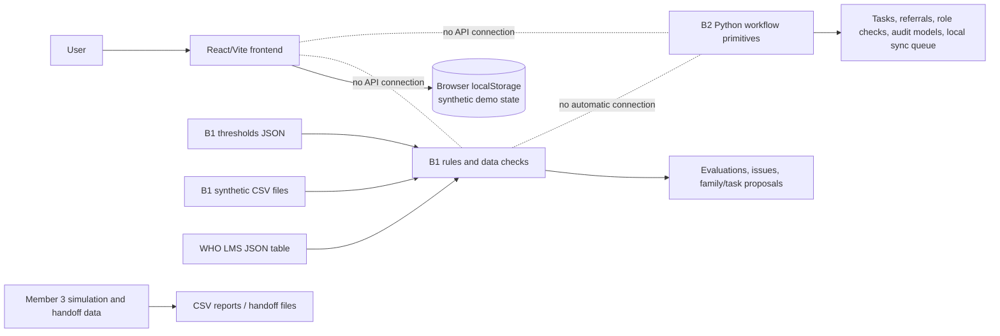

# Poshan Tracker Action Layer

Prototype workspace for exploring a nutrition action workflow: synthetic beneficiary and measurement data, configurable screening rules, data-quality checks, and follow-up task concepts. The repository contains separate frontend, Python rule-engine, Python workflow, and simulation work. **These parts are not connected into one running application.** The frontend is a standalone demo; Python modules are callable libraries and scripts, not an HTTP service. All bundled beneficiary data is synthetic.

## Objectives and status

The project explores how screening signals might be reviewed and turned into verification, referral, and follow-up work. It provides working prototype logic and user-interface flows for discussion. It is not a production health system, clinical decision tool, authentication system, or validated source of clinical guidance.

| Implemented in this repository | Planned, proposed, or incomplete |
| --- | --- |
| React/Vite screens with simulated roles, seeded synthetic records, local browser persistence, and casework interactions | Frontend-to-Python integration or a backend API |
| B1 rule evaluation, measurement trust checks, configurable thresholds, approval/override operations, and mother-child family links | Clinical/field validation of rule thresholds and operational schedules |
| B2 task, referral, fallback, role, audit/consent, and offline queue/synchronization primitives | Remote authenticated synchronization, durable production storage, encryption, server-side authorization |
| Member 3 synthetic data generation, analysis, and handoff utilities | Production data import, governance, retention, monitoring, recovery, and privacy/safety review |

## Technology

- Frontend: React, TypeScript, React Router, Vite, Tailwind CSS, and localStorage.
- B1 and B2: Python. B1 uses pandas; `who_growth.py` uses the repository's bundled `who_lms.json` table. B2 uses the Python standard library.
- Simulation: Python with pandas, NumPy, and Matplotlib (see `member3_data_simulation/requirements.txt`).
- Tests: Node's built-in test runner for the frontend utility test; Python `unittest` modules for B2; a standalone B1 assertion script.

## Architecture



See [architecture](docs/architecture.md) and [data flow](docs/data-flow.md) for responsibilities and workflow details. No API endpoints currently exist.

## Repository layout

```text
B1/                       Screening rules, validation, synthetic CSV/JSON, standalone checks
B2/                       Python task/referral/role/audit/offline-sync prototypes and unittest tests
frontend/                 Independent React/Vite user-interface demo and utility test
member3_data_simulation/  Synthetic data generation, alert analysis, validation, and handoff utilities
docs/                     Architecture and data-flow documentation
```

Module-specific setup and behavior: [B1/README.md](B1/README.md), [B2/README.md](B2/README.md), [frontend/README.md](frontend/README.md).

## Prerequisites

- Windows PowerShell.
- Node.js and npm compatible with the versions declared by the frontend lockfile/package manifest. Vite 8 requires a modern Node release; use a current supported Node LTS.
- Python 3.9+ for B2. B1 requires Python and pandas. Simulation dependencies are listed separately.
- No `.env` file or credentials are required for the current application. There is no configured Gemini/API integration despite inherited template dependencies and frontend template text.

## Install and run

### Frontend

```powershell
cd frontend
npm install --legacy-peer-deps
npm run dev
```

Vite prints the local URL (the manifest requests port 3000). The frontend is a standalone prototype. Role selection is simulated, and records persist in browser localStorage. See [frontend setup](frontend/README.md).

### B1 rule engine

```powershell
cd B1
python -m pip install pandas
python .\test_be1.py
```

`test_be1.py` copies B1 files to a temporary directory and runs its assertions against that copy. The rule engine can be imported by Python callers; it does not start a server. `build_data.py` regenerates synthetic data and can overwrite the checked-in CSV files, so do not run it unless regeneration is intended.

### B2 workflow library

From the repository root:

```powershell
python -m unittest B2.test_tasks B2.test_day2 -v
```

B2 has no third-party runtime requirements and no server entry point.

### Simulation utilities

```powershell
cd member3_data_simulation
python -m pip install -r requirements.txt
```

Inspect each script's arguments/source before running it: generation and handoff scripts write files, and simulation thresholds and operational schedules are explicitly proposed assumptions. See `handoff/README.txt`.

## Tests and build

From `frontend/`, run `npm test`, `npm run lint`, and `npm run build`. From the repository root, run the B2 unittest command above and `python .\B1\test_be1.py` (with pandas installed). These suites are independent; there is no end-to-end integration test because there is no integrated backend or API.

## Configuration and data

- B1 active rule values: `B1/thresholds.json`; reset baseline: `B1/thresholds_default.json`. `B1/rule_settings.py` keeps drafts/logs in its data directory. `BE1_DATA_DIR` changes the B1 CSV/settings directory and `THRESHOLDS_PATH` changes the active rule JSON path. These are Python environment variables, not frontend settings.
- Frontend fixtures and workflows: `frontend/src/store/mockStore.ts`; rule-like UI data is demo state and is not loaded from B1. The frontend stores its session and demo state in localStorage.
- B2 sync queue: caller-supplied local JSON path; the sync module does not contact a server.
- All checked-in CSV/person records are synthetic. Do not substitute real beneficiary data.

## Known limitations

- No HTTP API, database, shared schemas package, or live integration between frontend, B1, B2, and simulation utilities.
- Frontend route guards and role labels are client-side demonstrations, not security controls. The dashboard and screens should be treated as demo workflows.
- B2's audit/consent/task/referral models are in memory; its JSON queue is local and does not provide remote synchronization or encryption.
- Rule values and workflow timing assumptions need qualified review before any operational use. See each module README for details.

## Development guidelines

- Preserve the synthetic-data label and clearly distinguish executable code from proposals.
- Keep business rules in Python modules/configuration rather than duplicating them in UI text; when an integration is implemented, define and test an explicit shared contract first.
- Do not add credentials or real personal data. Keep generated outputs, caches, local environments, and dependency directories out of version control while retaining lockfiles and required fixtures.
- Make focused changes, run the affected module checks, and describe limitations honestly. Do not commit, merge, or push as part of this documentation review.

## Troubleshooting

- **npm install peer resolution:** use the documented `npm install --legacy-peer-deps` command for the current dependency declarations; resolve manifest/lockfile compatibility deliberately before removing the flag.
- **B1 import error for pandas:** install it with `python -m pip install pandas` in the Python environment used to run B1.
- **Frontend data differs from CSV:** expected; frontend fixtures/localStorage and B1 CSV data are separate. Clear the demo state via the UI's reset controls or browser storage if a stale demo session is the issue.
- **Rule edits affect local files:** set a temporary `BE1_DATA_DIR` and `THRESHOLDS_PATH` before invoking rule settings, or use the bundled B1 test which isolates writes in a temp copy.
