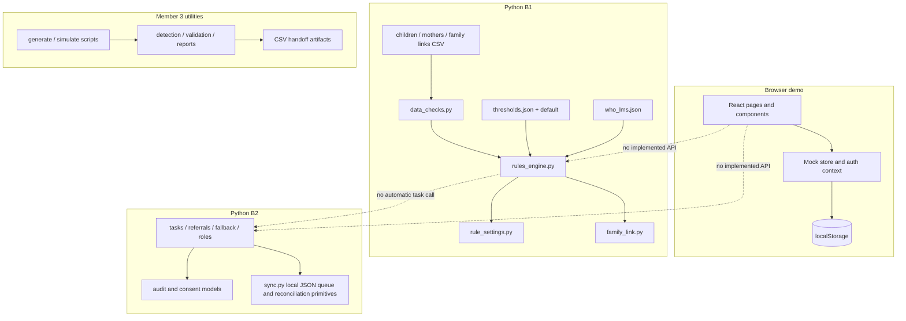

# Architecture and component responsibilities

## Current system boundary

This repository is a collection of prototypes, not a deployed multi-tier application. The React/Vite app runs independently in a browser. B1 and B2 are Python modules called directly by Python code. Member 3 scripts create and inspect synthetic datasets. There is no HTTP server, API contract, database, job runner, or automatic data exchange between these parts.

## Frontend

`frontend/src/main.tsx` mounts `App.tsx`. React Router selects landing/sign-in, dashboard, beneficiary, measurement, action queue, referral, rule, report, and staff-profile pages. Shared components and contexts provide layout, notifications, simulated session state, and route/role gating. Casework utility functions live in `src/utils`; `src/store/mockStore.ts` seeds and mutates the synthetic UI dataset and persists it in localStorage. This state is not sourced from B1 or B2.

## B1: screening and data trust

- `data_checks.py` validates child/mother input and marks untrusted child measurements for recheck.
- `rules_engine.py` reads threshold values from JSON, uses WHO LMS data for supported child growth calculations, and returns a colour, reasons, confidence, and issues for a row.
- `rule_settings.py` previews impacts and models draft, approval, rejection, override, reset, and history behavior using local JSON files.
- `family_link.py` joins family-link, child, and mother CSVs and can produce joint-visit task-shaped dictionaries.
- `build_data.py` creates synthetic input tables. `test_be1.py` validates core behavior using a temporary data copy.

## B2: workflow primitives

`tasks.py` models creation and lifecycle of tasks; `referrals.py` models referral attempts/outcomes; `fallback.py` describes manual fallback records; `roles.py` provides a proposed role/permission matrix and workload grouping/guard; `audit.py` models append-only event and consent histories; `sync.py` provides an atomic local queue and version-conflict reconciliation primitives. `demo_clock.py` supplies deterministic dates. These modules do not form an API and are not called by the frontend. The local queue/reconciliation functions do not establish a remote server connection.

## Data and integration layers

The data layer is file-based in B1 (CSV and JSON), browser-local in the frontend (seeded data and localStorage), in-memory for most B2 models, and generated-file based for simulation utilities. There is no shared database or common schema package. B1 output dictionaries and B2 task dictionaries are Python-level contracts, not network request/response formats. The B1 family-link helper creates task-shaped output, but no orchestrator automatically transfers it into B2 task storage.

## Configuration and tests

B1 thresholds and baseline values live in `B1/thresholds.json` and `B1/thresholds_default.json`; B1 path overrides are `BE1_DATA_DIR` and `THRESHOLDS_PATH`. Frontend workflows use source fixtures and browser storage. B2 accepts values and paths through function arguments. Tests are module-specific: Node test runner and TypeScript check/build for frontend, B1 assertion script, and B2 `unittest`. There is no integration suite.

## Security and readiness boundary

Client-side role guards are demo navigation controls, not authentication or authorization. B2 roles are prototype policy logic, not enforcement at a server boundary. Do not use real personal/health data. Production readiness requires reviewed identity/access control, secure transport/storage, durable audited persistence, validated rules/workflows, recovery/retention, and appropriate privacy and safety review.
