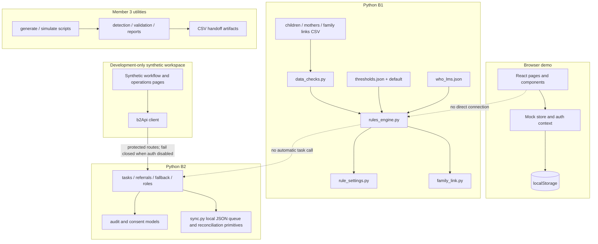

# Architecture and component responsibilities

## Current system boundary

This repository is a collection of prototypes, not a deployed multi-tier application. Original React/Vite dashboard, queue, and referral screens run from browser `mockStore`. Separate development-only synthetic workflow pages call B2's FastAPI API; they do not reuse or map the browser demo IDs. B1 is a Python rule/data module. B2 uses a local SQLite prototype store and has no production identity/database integration. Member 3 scripts create and inspect synthetic datasets.

## Frontend

`frontend/src/main.tsx` mounts `App.tsx`. React Router selects landing/sign-in, dashboard, beneficiary, measurement, action queue, referral, rule, report, and staff-profile pages. Shared components and contexts provide layout, notifications, simulated session state, and route/role gating. Casework utility functions live in `src/utils`; `src/store/mockStore.ts` seeds and mutates the synthetic UI dataset and persists it in localStorage. This state is not sourced from B1 or B2.

## B1: screening and data trust

- `data_checks.py` validates child/mother input and marks untrusted child measurements for recheck.
- `rules_engine.py` reads threshold values from JSON, uses WHO LMS data for supported child growth calculations, and returns a colour, reasons, confidence, and issues for a row.
- `rule_settings.py` previews impacts and models draft, approval, rejection, override, reset, and history behavior using local JSON files.
- `family_link.py` joins family-link, child, and mother CSVs and can produce joint-visit task-shaped dictionaries.
- `build_data.py` creates synthetic input tables. `test_be1.py` validates core behavior using a temporary data copy.

## B2: workflow primitives

`api.py` exposes prototype FastAPI routes for saved workflow records. `store.py` provides local prototype SQLite persistence. `tasks.py`, `referrals.py`, `exceptions.py`, `closure.py`, and `maternal.py` implement route-backed workflow operations; `roles.py` provides the backend permission policy, and `auth.py` defines the verified-identity adapter boundary. Authentication defaults to disabled; synthetic demo mode is explicit and is not production authentication. No Supabase verifier, operational assignment resolver, trusted hierarchy adapter, task-owner directory, or production repository is configured. `sync.py` provides a local JSON queue and simulated state reconciliation, not a remote server connection. The dedicated development workspace calls B2; protected requests remain unavailable until trusted auth is configured. Original mock-backed screens remain isolated.

## Data and integration layers

The data layer is file-based in B1 (CSV and JSON), browser-local in the frontend demo (seeded data and localStorage), SQLite-backed in the B2 prototype, and generated-file based for simulation utilities. There is no shared production database or common schema package. The dedicated B2 workspace uses explicit API request/response schemas; it does not map its identifiers to the original frontend demo IDs. The B1 family-link helper creates task-shaped output, but no orchestrator automatically transfers it into B2 task storage.

## Configuration and tests

B1 thresholds and baseline values live in `B1/thresholds.json` and `B1/thresholds_default.json`; B1 path overrides are `BE1_DATA_DIR` and `THRESHOLDS_PATH`. Frontend workflows use source fixtures and browser storage. B2 accepts values and paths through function arguments. Tests are module-specific: Node test runner and TypeScript check/build for frontend, B1 assertion script, and B2 `unittest`. There is no integration suite.

## Security and readiness boundary

Client-side role guards are demo navigation controls, not authentication or authorization. B2 enforces permission policy at its API boundary; its default mode denies protected access. The dedicated workspace obtains role and scope from the server profile and never treats UI visibility as security. Do not use real personal/health data. Production readiness requires verified identity/access control, a trusted hierarchy and assignment source, secure transport/storage, durable audited persistence, validated rules/workflows, recovery/retention, and appropriate privacy and safety review.
