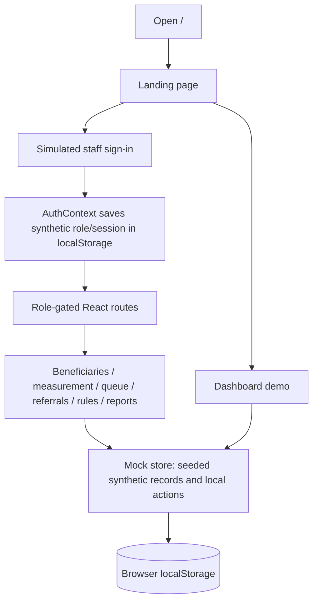
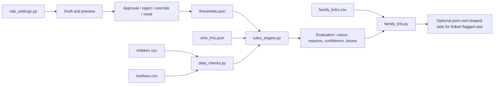
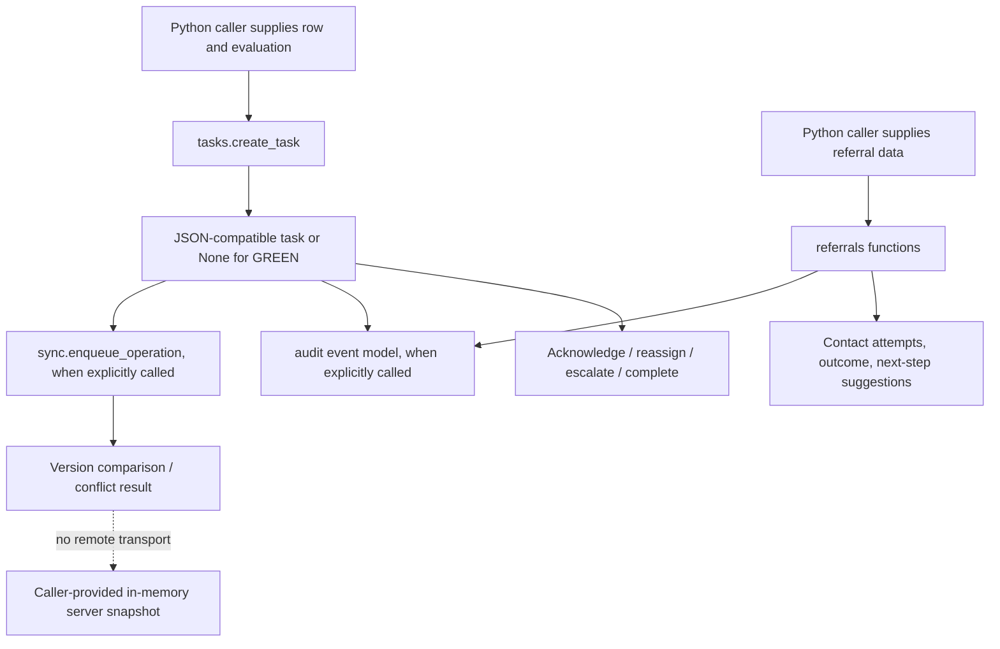
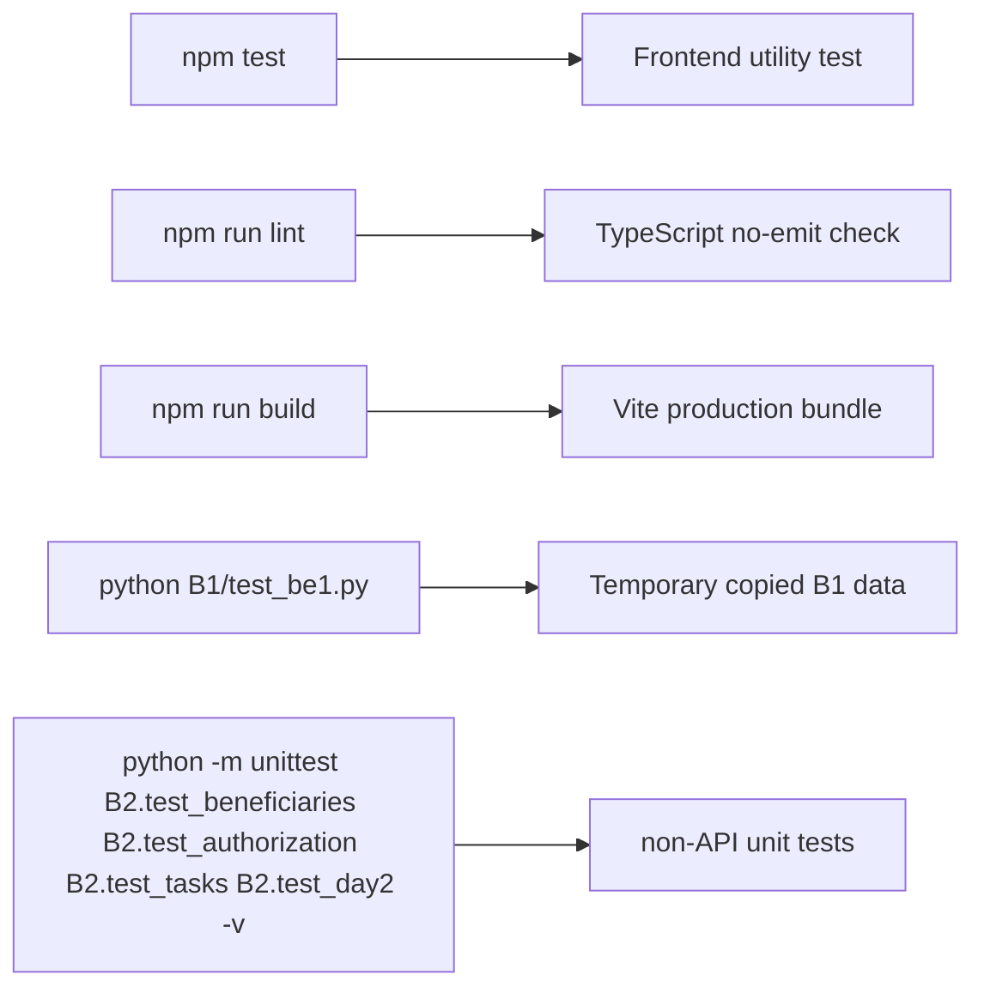

# Data flow and user workflows

## Frontend journey

The original Dashboard, Action Queue, and Referrals routes use browser-local `mockStore`; each remains an explicitly synthetic demo. In development builds, links open `/synthetic-workflow` or `/synthetic-operations`, separate pages that call B2 through `frontend/src/services/b2Api.ts`. They require a provider session and an active profile returned by B2. B2 currently has no configured trusted authentication adapters, so protected API requests remain unavailable with the required disabled-auth setting. No mock records are substituted when B2 fails, and no demo IDs are mapped to B2 IDs.

The original demo route list and role guards are in `frontend/src/App.tsx` and `context/AuthContext.tsx`; those role labels are UI state and do not imply backend access control or durable shared records. The synthetic workspace uses the provider session token for the server profile/API request, but that is not sufficient for access until B2 can resolve trusted assignments and scope.

## B1 input, checks, decisions, and settings

The engine validates child measurement trust before using anthropometric calculations, considers configured child/mother rules, and returns `RED`, `AMBER`, `GREEN`, or `GREY` (`GREY` means recheck rather than confirmed finding). `family_link.py` joins linked rows and can create one joint-visit task-shaped dictionary when both are RED/AMBER. It does not persist that task into B2. Rule settings write JSON state and can alter active thresholds; isolate data paths when experimenting.

## B2 task and referral workflow

The B2 FastAPI prototype exposes routes for saved workflow operations using the local SQLite prototype store. `sync.py` can persist a local queue and reconcile against an in-memory state passed by a caller; it does not connect to an actual server. Protected API access defaults to disabled. Do not enable demo identities in the normal application. Roles/capacity helpers are not frontend authentication. The escalation timing documented in Member 3's handoff is a placeholder assumption, not validated operational or clinical guidance.

## Validation and errors

B1 checks return issue dictionaries with codes, messages, suggestions, and affected measurements; rule settings raise `RuleSettingsError` for invalid requests. B2 functions validate arguments and raise module-specific `ValueError` subclasses; the FastAPI wrapper returns JSON errors and sanitizes request validation details. Original demo pages validate local inputs and report local interactions; separate synthetic workspace pages validate B2 responses and verify writes with fresh reads where the contract supports it. See [backend/frontend contract](backend-frontend-contract.md) and [synthetic operations contract](synthetic-operations-contract.md).

## Testing and execution flow

The checks are separate and do not validate an end-to-end integrated flow. See root setup commands and module READMEs.
