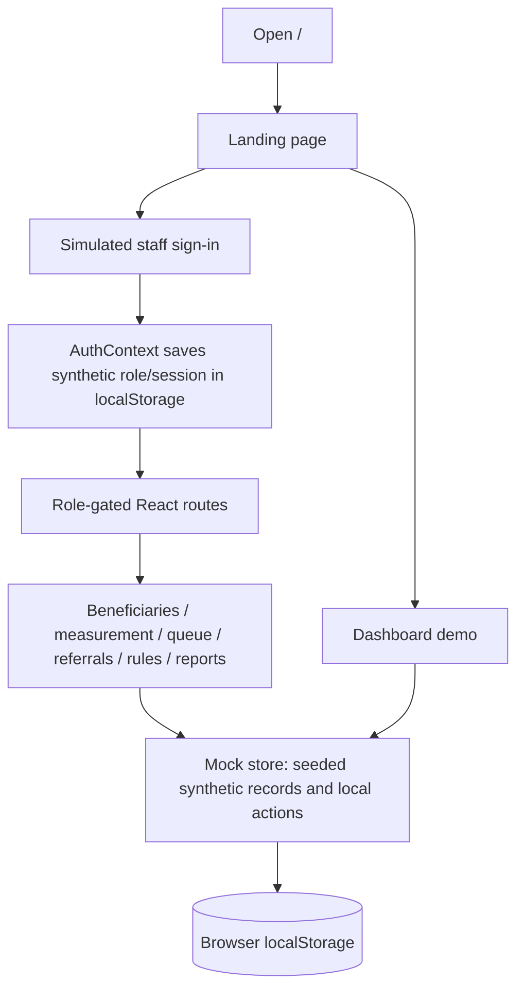
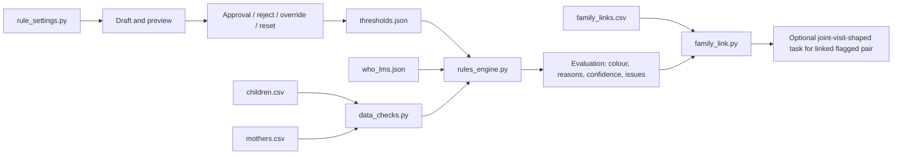
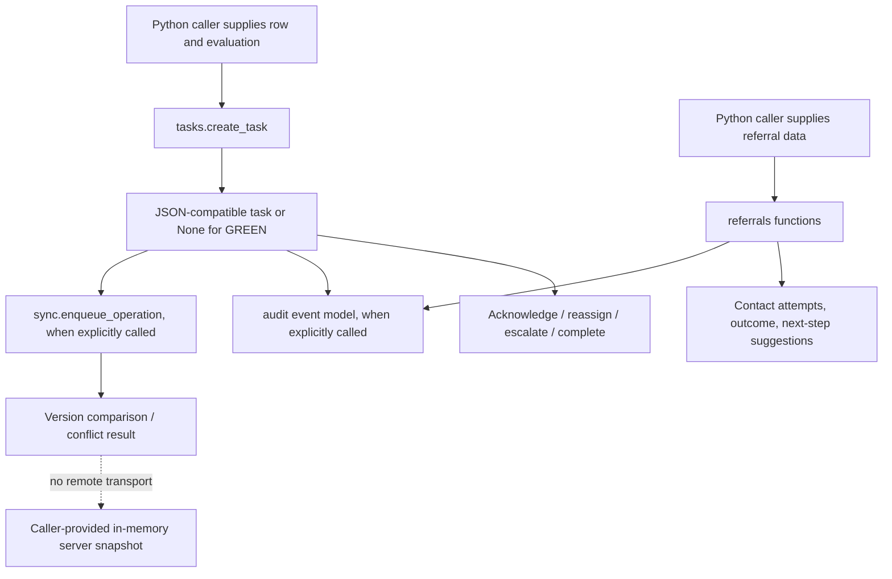
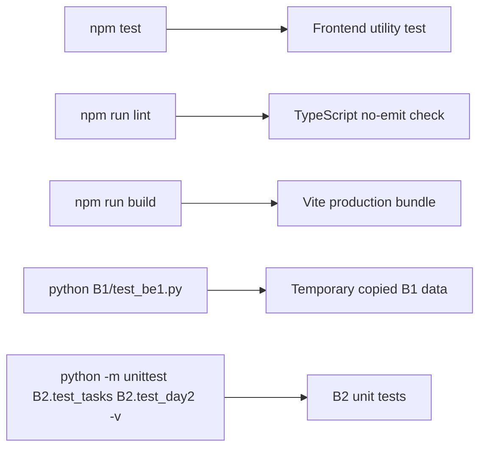

# Data flow and user workflows

## Frontend journey

The route list and route guards are in `frontend/src/App.tsx` and `context/AuthContext.tsx`; session roles are simulated by the UI. Public dashboard access and browser persistence do not imply backend access control or durable shared records. Some screens are illustrative; inspect their implementation before treating a displayed workflow as a connected service.

## B1 input, checks, decisions, and settings

The engine validates child measurement trust before using anthropometric calculations, considers configured child/mother rules, and returns `RED`, `AMBER`, `GREEN`, or `GREY` (`GREY` means recheck rather than confirmed finding). `family_link.py` joins linked rows and can create one joint-visit task-shaped dictionary when both are RED/AMBER. It does not persist that task into B2. Rule settings write JSON state and can alter active thresholds; isolate data paths when experimenting.

## B2 task and referral workflow

Task/referral operations are direct Python calls. `sync.py` can persist a local queue and reconcile against an in-memory state passed by a caller; it does not connect to an actual server. Roles/capacity checks are separate helpers and require callers to invoke them. The escalation timing documented in Member 3's handoff is a placeholder assumption, not validated operational or clinical guidance.

## Validation and errors

B1 checks return issue dictionaries with codes, messages, suggestions, and affected measurements; rule settings raise `RuleSettingsError` for invalid requests. B2 functions validate arguments and raise module-specific `ValueError` subclasses; task/referral objects remain caller-managed. Frontend casework utilities validate local inputs and the UI reports interactions through toast/context patterns. None of these error paths crosses a network boundary because no API exists.

## Testing and execution flow

The checks are separate and do not validate an end-to-end integrated flow. See root setup commands and module READMEs.
